<div align="center">
  
  <h1>FOROS — Talk to Robots</h1>
  <p><strong>Multimodal Spatial Reasoning, Workcell Perception, and Deterministic Multi-Vendor Robot Control Powered by the Meta Model API</strong></p>
  <p>
    <a href="https://foros.run"><strong>Live Interactive Demo (https://foros.run)</strong></a> ·
    <a href="#what-was-built-during-the-hackathon-oct-26--nov-4-2026"><strong>Hackathon Contributions</strong></a> ·
    <a href="#meta-model-api-architecture"><strong>Meta AI Pipeline</strong></a> ·
    <a href="#60-second-judge-walkthrough"><strong>Judge Walkthrough</strong></a>
  </p>
</div>

---

## Overview

**FOROS Action Engine (Meta Hackathon Edition)** is an industrial robotics control platform built for the **Meta Global AI Developer Hackathon** under the **Push the Frontier** problem statement (*"Give a machine a new capability... unlock a better way to understand and control a physical system"*).

Industrial robot arms from Universal Robots, KUKA, ABB, FANUC, Doosan, and Yaskawa each require proprietary, low-level programming languages (`URScript`, `KRL`, `RAPID`, `Karel`, `DRL`, `INFORM III`). At the same time, raw LLM code generation is unsafe for physical machinery due to coordinate hallucinations, joint-space sweeping collisions, and syntax variance.

**FOROS solves this by separating multimodal spatial reasoning from deterministic hardware compilation:**
1. **Voice Directive (`muse-voice-transcribe-1.0`)**: Factory operators issue spoken commands via Push-to-Talk ASR.
2. **Workcell Perception (`sam-3.1`)**: The cockpit renders a top-down orthographic view of the workcell and sends it to SAM 3.1 (`POST /v1/responses`, image + short visual prompt per part). Each returned box centre is projected into the robot base frame $(x, y)$; $z$ comes from the known part height. Without an API key, FOROS falls back to a calibrated workcell registry and labels it as such.
3. **Spatial Reasoning & Task Planning (`muse-spark-1.3`)**: Decomposes high-level natural language into a verified 4-stage spatial reasoning trace (`reasoning_steps`) and a sequence of atomic operation primitives (`ops`), enforcing safe approach/retract clearance planes ($z = 0.40\text{ m}$).
4. **Deterministic Compiler & Live URSim Execution (`ForosAdapter` + `URSim RTDE`)**: Clamps coordinates to an ISO 10218-inspired workspace envelope ($z \ge 0.15\text{ m}$, $r \le 0.80\text{ m}$), compiles the verified JSON graph into 12 industrial robot formats with zero syntax variance, and executes the trajectory live on a Universal Robots **UR5e Polyscope** controller streamed via noVNC.

---

## What Was Built During the Hackathon (Oct 26 – Nov 4, 2026)

> [!IMPORTANT]
> **Compliance with Section 4 (Hackathon Rules — New Work Only):**  
> This section explicitly identifies the code, features, and integrations developed during the Meta Global AI Developer Hackathon building period.

| Module | File(s) | Newly Built Hackathon Capabilities |
| :--- | :--- | :--- |
| **1. Meta `muse-spark-1.3` Spatial Reasoning Engine** | [`ursim_bridge.py`](./ursim_bridge.py) (`_muse_infer`, `infer_with_reasoning`) | Built the live OpenAI-compatible connector to `POST https://api.meta.ai/v1/chat/completions` (`model="muse-spark-1.3"`) with a domain-specific spatial grounding system prompt that outputs both a structured 4-stage engineering trace (`reasoning_steps`) and executable FOROS JSON primitives (`ops`). |
| **2. Meta `sam-3.1` Workcell Perception & Grounding** | [`ursim_bridge.py`](./ursim_bridge.py) (`segment_workspace`, `_sam_detect`, `_parse_sam_boxes`, `_pixel_to_base`), [`web/index.html`](./web/index.html) (`captureWorkcellTopDown`) | The cockpit renders a top-down orthographic image of the workcell with a known camera; the server sends it to `POST https://api.meta.ai/v1/responses` (`model="sam-3.1"`, streamed, `include_confidence`) once per part, parses the `<\|box;…\|>` records, and projects each box centre into the UR5e base frame. Detected positions replace the registry positions used for planning. Objects SAM does not find are reported as `NOT FOUND`; without a key the registry is used and labelled `REGISTRY` (no invented confidences). |
| **3. Meta `muse-voice-transcribe-1.0` Push-to-Talk ASR** | [`ursim_bridge.py`](./ursim_bridge.py) (`transcribe_voice`), [`ursim_web_interface.py`](./ursim_web_interface.py) (`/api/voice/transcribe`), [`web/index.html`](./web/index.html) | Built the multipart audio streaming bridge to `POST https://api.meta.ai/v1/asr/transcribe` (`model="muse-voice-transcribe-1.0"`, `mode="PUSH_TO_TALK"`) and the browser Push-to-Talk microphone capture interface. |
| **4. Interactive Perception & Spatial Plan Cockpit** | [`web/index.html`](./web/index.html) | Added the **SAM 3.1 Workcell Perception** interactive SVG segmentation viewport, 3D Three.js workcell object synchronization, and the **Muse Spatial Plan** inspection tab displaying verified perception, planning, kinematic safety, and compilation steps. |
| **5. Expanded Multi-Vendor Compiler (`ROS 2`, `DRL`, `INFORM`)** | [`foros_adapter.py`](./foros_adapter.py) (`_to_ros2`, `_to_drl`, `_to_inform`) | Added deterministic code generators for **ROS 2 Humble / MoveIt 2 (`rclpy`)**, **Doosan Robotics Language (`DRL`)**, and **Yaskawa Motoman (`INFORM III .JBI`)**, bringing total supported industrial protocols to 12. |
| **6. Pre-Compilation Safety & Disambiguation Verifier (ISO 10218-inspired limits)** | [`ursim_bridge.py`](./ursim_bridge.py) (`_verify_and_lock_ops_safety`, `_extract_task_sequence`, `get_execution_status`), [`foros_adapter.py`](./foros_adapter.py) | Built a deterministic verification gate that locks LLM waypoint outputs to the grounded object coordinates (`0.000m` drift), enforces hard reach ($r \le 0.80\text{ m}$) and table floor ($z \ge 0.15\text{ m}$) limits, blocks silent object substitution on unknown/ambiguous descriptions, and auto-recovers URSim protective stops via Dashboard port `29999`. |

---

## Meta Model API Architecture

```mermaid
flowchart LR
    subgraph Input["1. Multimodal Operator Input"]
        Mic["Push-to-Talk Audio"] -->|"POST /v1/asr/transcribe\n(muse-voice-transcribe-1.0)"| Prompt["Natural Language Directive"]
        Cam["Overhead Workcell View"] -->|"POST /v1/responses\n(sam-3.1)"| Seg["Calibrated 3D Workcell Map\n(x, y, z, confidence)"]
    end

    subgraph Reasoning["2. Agentic Spatial Reasoning"]
        Prompt --> Ground["Semantic Object Grounding"]
        Seg --> Ground
        Ground -->|"POST /v1/chat/completions\n(muse-spark-1.3)"| Plan["Spatial Reasoning Trace\n+ Atomic JSON Ops"]
    end

    subgraph Execution["3. Deterministic Safety & Hardware Execution"]
        Plan --> Clamp["Envelope Verifier (ISO 10218-inspired)\n(z >= 0.15m, r <= 0.80m)"]
        Clamp --> Compiler["FOROS Deterministic Adapter\n(12 Robot Protocols)"]
        Compiler -->|"TCP 30001 / RTDE 30004"| URSim["Live UR5e Polyscope Simulator\n+ 50Hz 3D Telemetry"]
    end
```



### Why Three Meta Models Together?
* **`muse-voice-transcribe-1.0`** enables hands-free voice operation in industrial environments (`PUSH_TO_TALK` mode).
* **`sam-3.1`** locates each part in the overhead workcell image, so plans target where the part actually is instead of hand-jogged teach-pendant coordinates. Accuracy is bounded by the camera resolution (≈1.6 mm/pixel for the 1.2 m × 1.2 m, 768 px view).
* **`muse-spark-1.3`** performs multi-step spatial reasoning—synthesizing safe approach heights ($z = 0.40\text{ m}$), grasp actuations, and retract trajectories before any machine code is emitted.

---

## Deterministic Safety Verifier (ISO 10218-inspired limits) — automated tests

Before any JSON operation graph is compiled into vendor robot code, [`ursim_bridge.py`](./ursim_bridge.py) enforces five deterministic invariants. They are simple workspace limits inspired by ISO 10218 — **not** a certified ISO 10218 safety function. Every scenario below is covered by [`tests/test_pipeline.py`](./tests/test_pipeline.py) (`python -m pytest -q`, 36 tests, no network needed).

**Refusal = hold still.** Every rejection emits a single `stop` operation (no `home`, no motion) and the cockpit disables **Send & Execute**.

**Verified, not silently fixed.** Model waypoints are snapped to grounded objects (reported in the trace as *N model op(s) corrected*), then checked without modification: floor/ceiling, reach, base column, and *no descent below the clearance plane except over a known object or an operator-given coordinate*. Any violation rejects the whole plan — nothing is compiled.


| Safety Invariant | Enforcement Mechanism | Verified Behavior |
| :--- | :--- | :--- |
| **1. Single-Source-of-Truth Coordinate Lock** | Cross-checks `muse-spark-1.3` waypoints against the grounded workcell objects (SAM 3.1 detections when live, registry otherwise; default registry: (`Aluminum Block A`: `[0.28, -0.22, 0.20]`, `Steel Spur Gear B`: `[0.32, 0.05, 0.18]`, `PCB Sensor Module C`: `[0.18, -0.32, 0.22]`, `Inspection Tray D`: `[-0.28, -0.22, 0.20]`). | `0.000m` coordinate drift across single- and multi-object sequences (`D1`–`D6`). |
| **2. Reach Envelope Gate ($r \le 0.80\text{ m}$)** | Computes Euclidean reach $r = \sqrt{x^2 + y^2 + z^2}$ for all requested targets prior to compilation. | Out-of-reach directives (e.g., `Move to x=2.0 y=0.5 z=0.3`, $r = 2.049\text{ m}$) are rejected with `REJECTED (r > 0.80m)` and `0` emitted moves (`D7`). |
| **3. Table Collision Gate ($z \ge 0.15\text{ m}$)** | Rejects any Z-axis target below the physical workcell safety floor ($z < 0.150\text{ m}$). | Sub-table directives (e.g., `z=0.05`) are blocked with `REJECTED (z < 0.15m)` and `SAFE HOLD` (`D8`). |
| **4. Disambiguation Safety Gate (Zero Silent Substitution)** | Inspects physical/color descriptors against the grounded workcell objects and blocks unknown object references. | Directives referencing nonexistent objects (e.g., `"Move the red block to the tray"`) are rejected with `REJECTED (OBJECT NOT FOUND)` and a clear disambiguation list (`D9`). |
| **5. Non-Operational Directive Filter** | Filters conversational or non-robotic text before planning. | Conversational inputs (e.g., `"Hello, how are you ?"`) emit `0` moves and remain in `STANDBY HOLD` (`D10`). |

---

## 60-Second Judge Walkthrough

The live deployment at **[https://foros.run](https://foros.run)** is open in **Public Judge Mode** (no account or login required):

1. **Inspect Workcell Perception (`sam-3.1`)**:
   - In the left panel under **SAM 3.1 Workcell Perception**, click **Scan Workcell**: the overhead view is sent to SAM 3.1 and each part shows its SAM confidence (or `REGISTRY` when no API key is configured). Click any object to ground it (e.g., **Aluminum Block A**).
   - Notice how the directive box automatically grounds the semantic object into a complete pick-and-place command targeting **Inspection Tray D**.
2. **Test Voice or Natural Language Input (`muse-voice-transcribe-1.0` & `muse-spark-1.3`)**:
   - Click **VOICE** to speak a directive (or type a custom command such as `"Pick up Steel Spur Gear B and place it on Inspection Tray D"`), then click **Generate Action**.
3. **Review the Spatial Reasoning Trace (`Muse Spatial Plan`)**:
   - In the right panel, switch between **Muse Spatial Plan** (Muse Spark 1.3's own reasoning trace, followed by the FOROS verifier report; the engine banner shows whether the live Meta API or the offline deterministic planner produced the plan), **JSON Ops (Model)**, and **Robot Script**.
   - Change the **Protocol** dropdown (`URScript`, `KUKA KRL`, `ABB RAPID`, `FANUC Karel`, `Doosan DRL`, `Yaskawa INFORM`, `ROS 2`) to see deterministic cross-brand compilation.
4. **Execute Live on the Universal Robots UR5e Simulator**:
   - In the center panel, watch the **3D Render** (synchronized at 50 Hz via RTDE) or switch to the **VNC Simulator** tab to see the real **Universal Robots Polyscope** controller.
   - Click **Send & Execute on Robot** to watch the UR5e arm execute the generated trajectory in real time.

---

## Supported Industrial Protocols (12 Formats)

| Manufacturer / Standard | Protocol / Language | Format Key | Execution / Simulation Interface |
| :--- | :--- | :--- | :--- |
| **Universal Robots** | URScript (`movel` / `movej`) | `urscript` | Live URSim Polyscope (TCP `30001`, RTDE `30004`, Dashboard `29999`) |
| **KUKA** | KUKA Robot Language (`.src`) | `krl` | KUKA.OfficeLite / Mock Controller (`7000`) |
| **ABB** | RAPID (`MODULE ForosModule`) | `rapid` | ABB RobotStudio / Mock Controller (`7001`) |
| **FANUC** | Karel / TP | `fanuc` | FANUC ROBOGUIDE / Mock Controller (`7002`) |
| **Doosan Robotics** | Doosan Robotics Language | `drl` | Doosan Virtual Robot (`7003`) |
| **Yaskawa Motoman** | INFORM III (`.JBI`) | `inform` | MotoSim EG-VRC |
| **Open Robotics (ROS 2)** | `rclpy` / MoveIt 2 Node | `ros2` | ROS 2 Humble WebSocket Bridge (`9091`) |
| **Open Robotics (ROS 1)** | `rospy` / MoveIt Commander | `ros1` | ROS 1 Noetic Rosbridge (`9090`) |
| **CNC / Motion Stages** | RS-274 G-Code | `serial` | Serial / GRBL / LinuxCNC |
| **Industrial PLC** | Modbus TCP Register Map | `modbus` | Holding Registers `40001–40007` |
| **Audit / Verification** | Human-Readable Step Trace | `plain_text` | Safety Inspector Log |
| **Intermediate Graph** | Clamped FOROS JSON Schema | `json` | Verifier-checked op graph |

---

## Engine Modes (what runs when)

| Mode | When | Planner | Perception | UI label |
| :--- | :--- | :--- | :--- | :--- |
| **Live Meta API** | `MODEL_API_KEY` set | `muse-spark-1.3` (its reasoning trace is shown verbatim, then the FOROS verifier report) | `sam-3.1` on the rendered overhead view | `ENGINE MODE: LIVE META API` · objects show `SAM xx%` |
| **Offline** | no key / API unreachable | deterministic rule-based planner | calibrated workcell registry | `OFFLINE DETERMINISTIC PLANNER` · objects show `REGISTRY` |

In both modes the same deterministic verifier and compiler run before any code reaches a robot.

## Local Installation & Setup

### Prerequisites
* Python 3.10+
* A valid **Meta Model API Key** from [dev.meta.ai](https://dev.meta.ai) (`muse-spark-1.3`, `sam-3.1`, `muse-voice-transcribe-1.0`)
* *(Optional)* Docker for running the local Universal Robots URSim container (`universalrobots/ursim_e-series`)

### 1. Clone the Repository
```bash
git clone https://github.com/Volgat/foros-meta-hackathon.git
cd foros-meta-hackathon
pip install -r requirements.txt
```

### 2. Configure `.env`
```bash
cp .env.example .env
```
Edit `.env` and insert your Meta Model API key:
```ini
MODEL_API_KEY=your_meta_model_api_key_here
MUSE_API_BASE=https://api.meta.ai/v1
MUSE_MODEL=muse-spark-1.3
SAM_MODEL=sam-3.1
VOICE_MODEL=muse-voice-transcribe-1.0
```

### 3. Run the Control Server
```bash
# With a live URSim container on 127.0.0.1:
python ursim_web_interface.py --port 8080 --ip 127.0.0.1

# Or in dry-run simulation mode (no Docker container required):
python ursim_web_interface.py --port 8080 --dry-run
```
Open `http://localhost:8080` in your browser.

### 4. Run the tests
```bash
pip install pytest
python -m pytest -q
```

---

## Repository Structure

```text
foros-meta-hackathon/
├── ursim_bridge.py          # Meta Model API client (muse-spark-1.3, sam-3.1, muse-voice-transcribe-1.0) + URSim TCP/Dashboard bridge
├── ursim_web_interface.py   # HTTP/REST control server (/api/process, /api/vision/segment, /api/voice/transcribe, /api/send)
├── foros_adapter.py         # Deterministic multi-brand compiler (12 industrial robot protocols + workspace safety clamps)
├── ursim_feedback.py        # 50 Hz Real-Time Data Exchange (RTDE port 30004) telemetry engine
├── foros_db.py              # SQLite telemetry & audit logger
├── tests/test_pipeline.py   # 36 deterministic tests: safety gates D1–D10, hold-still refusals, strict verifier, SAM parser/projection, 12 compilers
├── web/
│   ├── index.html           # Industrial 3D/VNC control cockpit, SAM 3.1 viewport, and Muse Spatial Plan inspector
│   ├── logo_dark.png        # FOROS brand assets
│   └── logo_light.png
└── simulators/              # Docker Compose definitions for URSim and multi-vendor mock controllers
```

---

## Team & Acknowledgments

* **Team Name:** Volgat (Indie Developer Track — Solo Participant)
* **Built With:** Meta Model API (`muse-spark-1.3`, `sam-3.1`, `muse-voice-transcribe-1.0`), Universal Robots URSim, Three.js, noVNC.
